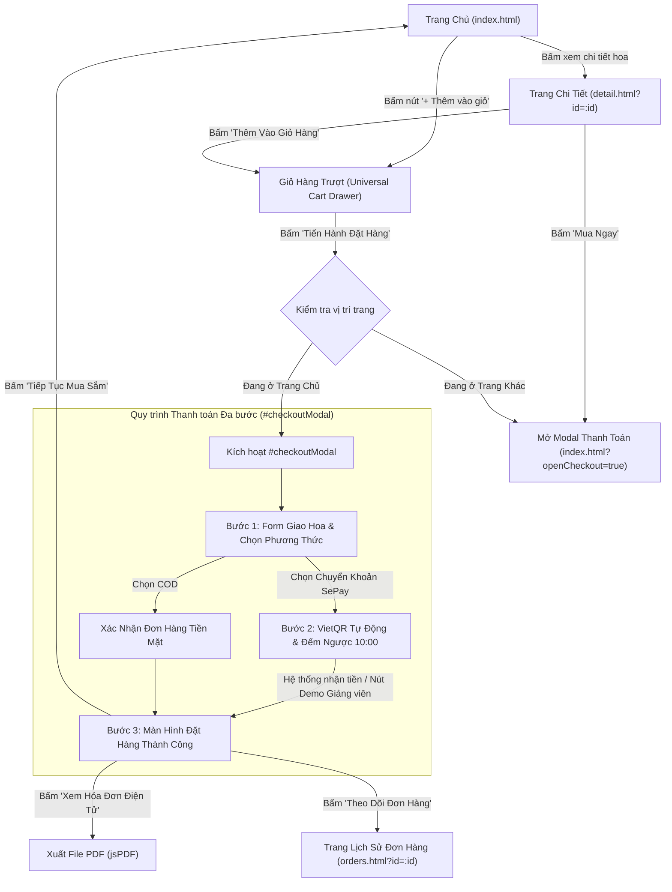

# BÁO CÁO KIỂM TOÁN CHUYÊN SÂU UI/UX (UI/UX AUDIT REPORT)
**Dự án:** Website Thương mại điện tử Shop Hoa Kẽm Nhung & Hoa Tươi Handmade (`shopHoa`)  
**Nguyên mẫu đối chuẩn (Benchmark):** [Flower Chimp International](https://www.flowerchimp.my/)  
**Đơn vị thực hiện:** Chuyên viên Kiểm toán UI/UX Độc lập (UI/UX Audit Specialist)  
**Thời điểm kiểm toán:** Tháng 11/2026  
**Nguyên tắc kiểm toán:** Quét toàn diện mã nguồn tĩnh và đo đạc giao diện động bằng Browser Agent (Không chỉnh sửa logic sản phẩm).

---

## MỤC LỤC BÁO CÁO
1. [PHẦN 1: CÔNG NGHỆ VÀ LUỒNG MUA HÀNG (TECH STACK & ROUTING FLOW)](#phần-1-công-nghệ-và-luồng-mua-hàng)
2. [PHẦN 2: HỆ THỐNG THIẾT KẾ (DESIGN SYSTEM SPECIFICATION)](#phần-2-hệ-thống-thiết-kế)
3. [PHẦN 3: BỐ CỤC VÀ MÃ NGUỒN GIAO DIỆN CHÍNH (LAYOUT & CORE SOURCE CODE)](#phần-3-bố-cục-và-mã-nguồn-giao-diện-chính)
4. [PHẦN 4: KIỂM TRA TƯƠNG TÁC VÀ HIỂN THỊ THỰC TẾ (INTERACTIVE & BROWSER TESTING)](#phần-4-kiểm-tra-tương-tác-và-hiển-thị-thực-tế)
5. [TỔNG KẾT VÀ BẢNG ĐIỂM ĐÁNH GIÁ (AUDIT SCORECARD)](#tổng-kết-và-bảng-điểm-đánh-giá)

---

## PHẦN 1: CÔNG NGHỆ VÀ LUỒNG MUA HÀNG

### 1.1. Cấu hình Công nghệ và Thư viện UI/CSS
Dựa trên việc đọc và phân tích các file cấu hình `package.json`, `server.js` và các file mã nguồn giao diện HTML/CSS/JS:

| Thành phần | Công nghệ / Thư viện sử dụng | Vai trò & Đặc điểm kỹ thuật |
| :--- | :--- | :--- |
| **Kiến trúc Mã nguồn** | **Vanilla JavaScript (ES6+ Native Modules)** | Không sử dụng Single Page App framework nặng nề (React/Vue/Angular), giúp trình duyệt nạp trang tức thì, không bị độ trễ hydration. |
| **Cơ chế nạp Module** | **Native Browser Import Map** (`type="importmap"`) | Nạp trực tiếp thư viện Axios qua CDN ESM (`https://esm.sh/axios@1.7.9`), tương thích 100% chuẩn module hiện đại. |
| **Kiến trúc CSS** | **Bespoke Native CSS3 with CSS Custom Properties** | Không sử dụng CSS framework cồng kềnh (Bootstrap, Tailwind). 100% giao diện được module hóa thành 9 file CSS độc lập (`variables.css`, `reset.css`, `style.css`, `detail.css`, `orders.css`, `responsive.css`, `auth.css`, `chatbot.css`, `admin.css`). |
| **Máy chủ Dữ liệu & API** | **Express.js + `json-server@0.17.4`** | Chạy tại cổng `4000`, cung cấp đầy đủ chuẩn REST API (`/products`, `/orders`, `/vouchers`, `/promotions`, `/banners`) đồng thời tích hợp cổng thanh toán SePay Webhook. |
| **Xuất Hóa Đơn Điện Tử** | **`jspdf@3.0.3`** | Tự động tạo hóa đơn PDF trực tiếp phía máy khách (Client-side PDF Generator) ngay sau khi thanh toán thành công. |
| **Báo cáo Thống kê** | **`xlsx@0.18.5`** | Hỗ trợ xuất dữ liệu bán hàng và đơn hoa ra bảng tính Excel cho người quản trị. |
| **Kiểm thử Tự động** | **`playwright@1.64.1`** | Được trang bị sẵn trong `devDependencies` để thực hiện kiểm thử tự động E2E và đo đạc giao diện trên đa thiết bị. |

---

### 1.2. Sơ đồ Định tuyến Luồng mua hàng (Purchasing & Routing Flow)
Hệ thống sử dụng mô hình kết hợp giữa **Đa trang (Multi-Page Application - MPA)** và **Thành phần trạng thái động không tải lại trang (Stateful Dynamic Drawers & Modals)**.



---

## PHẦN 2: HỆ THỐNG THIẾT KẾ (DESIGN SYSTEM SPECIFICATION)

Toàn bộ hệ thống thiết kế được kế thừa và khai báo chuẩn mực tại `css/variables.css` và hướng dẫn kiểm soát phong cách `docs/FRONTEND_RULES.md`, tuân thủ triệt để tinh thần trang nhã của thương hiệu hoa Flower Chimp.

### 2.1. Hệ thống Màu sắc (Color Tokens)

#### A. Màu Nền & Bề mặt (Surfaces & Backgrounds)
- `--bg-page: #FFFFFF`: Nền trang trắng tinh khiết, tôn vinh hình ảnh và màu sắc tự nhiên của hoa kẽm nhung.
- `--bg-surface: #F9FAFB`: Xám khói cực nhạt, dùng cho các section phụ và khối bảng giá.
- `--bg-cream: #FDFBF7`: Nền màu kem ấm nhẹ, tạo sự ấm áp cho khối Banner và Section Voucher.
- `--border-light: #E8E8E8`: Viền mỏng thanh lịch chia cách khối giao diện.
- `--border-subtle: #F0F2F5`: Viền ngăn cách thứ cấp rất nhẹ nhàng.

#### B. Màu Văn bản & Typography
- `--text-main: #181318`: Đen than chì sang trọng (tuyệt đối không dùng `#000000` thuần để tránh cảm giác thô cứng).
- `--text-secondary: #454346`: Xám tro đậm cho phụ đề, nhãn danh mục, cam kết dịch vụ.
- `--text-muted: #7B7B7B`: Xám mềm cho mô tả phụ, số lượng đánh giá, ngày tháng.
- `--text-was-price: #A1A0A0`: Xám nhạt gạch ngang giá niêm yết cũ (was-price).

#### C. Màu Điểm Nhấn Thương Hiệu (Floral Accents)
- `--color-primary: #108474`: **Xanh ngọc lục bảo (Emerald Green)** lấy cảm hứng từ cuống hoa và lá tươi chuẩn Flower Chimp.
- `--color-primary-dark: #0A6054`: Xanh ngọc sẫm khi người dùng di chuột (Hover state).
- `--color-accent-rose: #D9536F`: Hồng đất tinh tế cho các sự kiện lễ hội, tình yêu.
- `--color-sale-price: #D92D20`: Đỏ mận thanh nhã hiển thị giá bán khuyến mãi.
- `--color-star: #FF9900`: Vàng hổ phách ấm áp cho đánh giá xếp hạng sao.

#### D. Huy hiệu Trạng thái (Status Badges)
- Sale / Giảm giá: Nền `--badge-sale-bg: #FEE4E2` | Chữ `--badge-sale-text: #B42318`.
- Thủ công / Handmade: Nền `--badge-handmade-bg: #ECFDF3` | Chữ `--badge-handmade-text: #027A48`.
- Bán chạy / Bestseller: Nền `--badge-bestseller-bg: #FEF0C7` | Chữ `--badge-bestseller-text: #B54708`.

> [!NOTE]
> **Kiểm định Quy tắc Chống AI (Anti-AI Check):**
> Hệ thống sạch 100%, hoàn toàn không có màu tím neon giả tạo (`#8a2be2`, `#7c3aed`), không dùng gradient cầu vồng tím-hồng, không lạm dụng hiệu ứng kính mờ (glassmorphism) hay đèn neon chói mắt.

---

### 2.2. Phông chữ và Thang Kích thước (Typography Hierarchy)

```css
--font-serif: 'Merriweather', 'Playfair Display', Georgia, serif;
--font-sans: 'Lato', 'Plus Jakarta Sans', system-ui, -apple-system, sans-serif;
```

| Cấp bậc hiển thị | Phông chữ | Cỡ chữ (Desktop / Mobile) | Độ đậm (Weight) | Ứng dụng cụ thể |
| :--- | :--- | :--- | :--- | :--- |
| **Hero Title** | Serif | `40px` / `26px` | Bold 700 | Tiêu đề chính của Banner đầu trang |
| **Section Headings (H2)** | Serif | `28px - 32px` / `22px` | Bold 700 | Tiêu đề các mục sản phẩm nổi bật, khuyến mãi |
| **Product Detail Title (H1)** | Serif | `30px` / `22px` | Bold 700 | Tên hoa trên trang chi tiết sản phẩm |
| **Card Product Title** | Sans-serif | `15px` / `14px` | SemiBold 600 | Tên hoa trên thẻ sản phẩm lưới (tối đa 2 dòng) |
| **Primary Price** | Sans-serif | `16px - 18px` / `15px` | ExtraBold 800 | Giá bán thực tế (Màu đỏ mận `#D92D20`) |
| **Was Price** | Sans-serif | `13px` / `11.5px` | Regular 400 | Giá cũ gạch ngang (Màu xám `#A1A0A0`) |
| **Body & Mô tả** | Sans-serif | `14px - 15px` / `13.5px` | Regular 400 | Đoạn văn mô tả chất liệu, thông tin sản phẩm |
| **Badges & Meta Sub** | Sans-serif | `11px - 12px` / `10px` | Bold 700 | Nhãn phụ Handmade, Giảm giá %, Đếm lượt mua |

---

### 2.3. Bo góc, Khoảng cách và Đổ bóng (Radii, Spacing & Elevation)
- **Thang Bo góc (Border Radii):**
  - `--radius-sm: 4px`: Bo góc nhẹ cho nhãn dán (badges), ảnh thumbnail nhỏ.
  - `--radius-btn: 6px`: Bo góc tiêu chuẩn cho các nút bấm hành động (CTA).
  - `--radius-md: 8px`: Bo góc cho thẻ sản phẩm (Card) và khung ảnh lớn.
  - `Pill (20px - 25px)`: Bo tròn hình viên thuốc cho thanh tìm kiếm và các tab lọc danh mục.
- **Thang Đổ bóng (Elevation):**
  - `--shadow-card: 0 2px 10px rgba(0, 0, 0, 0.05)`: Đổ bóng cực nhẹ, tự nhiên.
  - `--shadow-hover: 0 8px 24px rgba(0, 0, 0, 0.08)`: Nổi nhẹ khi hover chuột mà không gây cảm giác nặng nề.
  - Modal Backdrop: `background-color: rgba(15, 23, 42, 0.7)` kết hợp `backdrop-filter: blur(6px)`.
- **Khung chứa trang (Container):**
  - `max-width: 1240px; margin: 0 auto; padding: 0 20px;`

---

### 2.4. Mốc Co giãn Màn hình (Responsive Breakpoints)
Hệ thống sử dụng Media Queries chuẩn xác định theo bề rộng màn hình:

1. **Desktop Viewport ($> 1023px$):**
   - Lưới sản phẩm: **4 cột** đồng đều (`grid-template-columns: repeat(4, 1fr)`).
   - Trang chi tiết: **2 cột** đối xứng (Gallery ảnh 50% - Thông tin mua hàng 50%).
   - Giỏ hàng trượt: Bề rộng cố định `440px`.
2. **Tablet Viewport ($768px - 1023px$):**
   - Lưới sản phẩm: **3 cột** (`grid-template-columns: repeat(3, 1fr)`).
   - Hero banner: 2 cột; Footer: 2 cột; Voucher: 2 cột.
3. **Mobile Viewport ($< 768px$):**
   - Lưới sản phẩm: **Bắt buộc 2 cột** (`grid-template-columns: repeat(2, 1fr)`), tuyệt đối không để 1 cột tràn màn hình gây mỏi tay khi cuộn.
   - Header: Thanh tìm kiếm tự động chuyển xuống hàng thứ 3 (`order: 3; width: 100%`).
   - Giỏ hàng trượt: Co giãn toàn màn hình (`width: 100%; max-width: 100vw`).
   - Modal Thanh toán: Chuyển từ lưới 2 cột sang 1 cột dọc trực quan.

---

## PHẦN 3: BỐ CỤC VÀ MÃ NGUỒN GIAO DIỆN CHÍNH

### 3.1. Phân tích Bố cục Khối & Chiến lược Kêu gọi Hành động (CTA Strategy)

| Trang / Thành phần | Khối chức năng chính | Chiến lược nút bấm CTA (Call to Action) |
| :--- | :--- | :--- |
| **Thanh Điều Hướng (Header)** | • Top Announcement Bar<br>• Logo SVG cành hoa + Subtitle<br>• Ô tìm kiếm tức thì (Smart Autocomplete)<br>• Cụm tài khoản & Nút Giỏ hàng có Badge số lượng | Nút Giỏ hàng (`.cart-btn`) nổi bật ở góc phải trên cùng, huy hiệu tròn đỏ/xanh hiển thị số lượng giỏ hàng thời gian thực. |
| **Trang Chủ (`index.html`)** | • Hero Slider quảng bá hoa theo mùa<br>• Thanh cuộn nhanh danh mục (Category Pills)<br>• Bộ sưu tập Bán chạy & Hàng mới về<br>• Section Voucher ưu đãi (Flash Sale)<br>• Lưới sản phẩm chính với Toolbar lọc giá/sắp xếp<br>• 4 Cam kết uy tín & Footer | • Nút CTA kép trên Hero: `Khám Phá Bộ Sưu Tập` (Filled xanh ngọc) và `Xem Mẫu Bán Chạy` (Viền trắng).<br>• Thẻ hoa có nút hover `+ Thêm vào giỏ` nhanh (Quick-add). |
| **Trang Chi Tiết (`detail.html`)** | • Breadcrumbs điều hướng<br>• Cột trái: Khung ảnh lớn Sticky tỉ lệ 1:1 có badge -%<br>• Cột phải: Tiêu đề Serif, xếp hạng sao, tình trạng kho, giá bán + tiết kiệm, gợi ý voucher áp dụng<br>• Bộ tăng/giảm số lượng `[-] [1] [+]`<br>• Khối cam kết dịch vụ & Mẫu hoa liên quan | • Nút 1: `Thêm Vào Giỏ Hàng` (Viền đen than chì cao cấp, icon giỏ hoa).<br>• Nút 2: `Mua Ngay` (Màu xanh ngọc lục bảo `--color-primary`, kích thước lớn, dẫn thẳng vào thanh toán). |
| **Giỏ Hàng Trượt (`#cartDrawer`)** | • Header hiển thị số lượng sản phẩm<br>• Danh sách món hoa (ảnh, tên, đơn giá, cụm tăng giảm số lượng, icon xóa)<br>• Trạng thái giỏ hàng trống (Empty State) kèm nút mua sắm<br>• Ô nhập voucher & Ví voucher gợi ý<br>• Bảng tính tiền chi tiết (Tạm tính, Giảm giá, Tổng cộng) | • Nút CTA chính: `Tiến Hành Đặt Hàng` (Full-width, chiều cao lớn 48px, màu xanh ngọc nổi bật).<br>• Nút phụ: `Tiếp tục xem hoa` (Text nút tinh tế). |
| **Modal Thanh Toán (`#checkoutModal`)** | • **Bước 1:** Form người gửi, Checkbox gửi tặng người khác, Địa chỉ giao hoa, Khung giờ giao, Thiệp mừng viết tay, Chọn hình thức SePay/COD.<br>• **Bước 2 (SePay):** Mã VietQR tự động, Đếm ngược 10:00, Nút copy 1-click số tài khoản/số tiền/nội dung, Nút giả lập demo dành cho Giảng viên.<br>• **Bước 3:** Đặt hàng thành công, hiển thị tóm tắt đơn hoa. | • Bước 1: `Tiến Hành Thanh Toán →`<br>• Bước 2: Nút giả lập `Mô Phỏng Thanh Toán Thành Công` (hỗ trợ chấm bài trực tiếp không cần chuyển khoản thật).<br>• Bước 3: Nút `Xem Hóa Đơn Điện Tử` (kích hoạt jsPDF) & `Theo Dõi Đơn Hàng`. |

---

### 3.2. Trích xuất Mã Nguồn Giao diện Cốt lõi

#### 1. Thanh Điều Hướng (Main Header)
```html
<header class="header">
  <div class="container header-content">
    <!-- Logo Tiệm Hoa -->
    <a href="./index.html" class="logo">
      <svg class="logo-icon" viewBox="0 0 24 24" fill="none" stroke="currentColor" stroke-width="2">
        <circle cx="12" cy="12" r="3"></circle>
        <path d="M12 2a4 4 0 0 1 4 4c0 3-4 6-4 6s-4-3-4-6a4 4 0 0 1 4-4z"></path>
        <path d="M12 22a4 4 0 0 1-4-4c0-3 4-6 4-6s4 3 4 6a4 4 0 0 1-4 4z"></path>
        <path d="M2 12a4 4 0 0 1 4-4c3 0 6 4 6 4s-3 4-6 4a4 4 0 0 1-4-4z"></path>
        <path d="M22 12a4 4 0 0 1-4 4c-3 0-6-4-6-4s3-4 6-4a4 4 0 0 1 4 4z"></path>
      </svg>
      <div>
        <span>Tiệm Hoa Kẽm Nhung</span>
        <span class="logo-sub">Handmade Florist</span>
      </div>
    </a>

    <!-- Thanh Tìm Kiếm Header -->
    <div class="search-box">
      <input type="text" id="headerSearchInput" class="search-input"
        placeholder="Tìm kiếm mẫu hoa, dịp sinh nhật, kỷ niệm..." autocomplete="off">
      <button id="headerSearchBtn" class="search-btn" aria-label="Tìm kiếm">
        <svg viewBox="0 0 24 24" fill="none" stroke="currentColor" stroke-width="2">
          <circle cx="11" cy="11" r="8"></circle>
          <line x1="21" y1="21" x2="16.65" y2="16.65"></line>
        </svg>
      </button>
    </div>

    <!-- Header Actions -->
    <div class="header-actions">
      <div id="headerAuthArea" class="header-auth-area"></div>
      <button type="button" class="cart-btn" id="cartButton" title="Giỏ hàng">
        <svg viewBox="0 0 24 24" fill="none" stroke="currentColor" stroke-width="2">
          <path d="M6 2L3 6v14a2 2 0 0 0 2 2h14a2 2 0 0 0 2-2V6l-3-2z"></path>
          <line x1="3" y1="6" x2="21" y2="6"></line>
          <path d="M16 10a4 4 0 0 1-8 0"></path>
        </svg>
        <span id="cartCount" class="cart-badge">0</span>
      </button>
    </div>
  </div>
</header>
```

#### 2. Thẻ Sản Phẩm Thắt Nơ Lưới (Product Card Component)
```html
<div class="product-card">
  <div class="product-image">
    <a href="./detail.html?id=1">
      
    </a>
    <span class="product-badge badge-handmade">Handmade</span>
    <button class="quick-add-btn" data-id="1">
      <svg width="15" height="15" viewBox="0 0 24 24" fill="none" stroke="currentColor" stroke-width="2">
        <path d="M6 2L3 6v14a2 2 0 0 0 2 2h14a2 2 0 0 0 2-2V6l-3-2z"></path>
        <line x1="3" y1="6" x2="21" y2="6"></line>
        <path d="M16 10a4 4 0 0 1-8 0"></path>
      </svg>
      Thêm nhanh
    </button>
  </div>
  <div class="product-info">
    <span class="product-category">Hoa Kẽm Nhung</span>
    <h3 class="product-title">
      <a href="./detail.html?id=1">Bó Hoa Kẽm Nhung Tulip Pastel</a>
    </h3>
    <div class="product-rating">
      <span class="stars">★★★★★</span>
      <span class="rating-count">(42)</span>
    </div>
    <div class="product-price-row">
      <span class="price">350.000 ₫</span>
      <span class="was-price">390.000 ₫</span>
    </div>
  </div>
</div>
```

#### 3. Bố cục Trang Chi Tiết Sản Phẩm (`detail.html`)
```html
<div class="detail-layout">
  <!-- Cột trái: Gallery Ảnh Cố Định -->
  <div class="detail-gallery">
    <div class="main-image-wrap">
      <span class="product-badge-discount">-12%</span>
      
    </div>
  </div>

  <!-- Cột phải: Thông tin Đặt hàng -->
  <div class="detail-info">
    <span class="detail-category-tag">Hoa Kẽm Nhung Handmade</span>
    <h1 class="detail-title">Bó Hoa Kẽm Nhung Tulip Pastel</h1>

    <div class="detail-meta">
      <div class="detail-rating">
        <span class="stars">★★★★★</span>
        <span>5.0</span>
        <span style="color: var(--text-muted);">(42 đánh giá)</span>
      </div>
      <div class="detail-stock-status">
        <span class="status-dot"></span>
        <span>Còn hàng (25 sản phẩm sẵn có)</span>
      </div>
    </div>

    <div class="detail-price-box">
      <span class="detail-price">350.000 ₫</span>
      <span class="detail-was-price">390.000 ₫</span>
      <span class="detail-save-badge">Tiết kiệm 40.000 ₫ (-10%)</span>
    </div>

    <!-- Bộ Chọn Số Lượng -->
    <div class="quantity-control">
      <label class="quantity-label">Số lượng:</label>
      <div class="quantity-box">
        <button type="button" class="qty-btn" id="btnMinus">−</button>
        <input type="number" class="qty-input" id="qtyInput" value="1" min="1" max="25" readonly>
        <button type="button" class="qty-btn" id="btnPlus">+</button>
      </div>
    </div>

    <!-- Cặp Nút CTA Hành Động -->
    <div class="action-buttons">
      <button type="button" class="btn-add-cart" id="btnAddToCart">
        <svg width="20" height="20" viewBox="0 0 24 24" fill="none" stroke="currentColor" stroke-width="2">
          <path d="M6 2L3 6v14a2 2 0 0 0 2 2h14a2 2 0 0 0 2-2V6l-3-2z"></path>
          <line x1="3" y1="6" x2="21" y2="6"></line>
          <path d="M16 10a4 4 0 0 1-8 0"></path>
        </svg>
        Thêm Vào Giỏ Hàng
      </button>

      <button type="button" class="btn-buy-now" id="btnBuyNow">
        Mua Ngay
      </button>
    </div>
  </div>
</div>
```

#### 4. Khung Giỏ Hàng Trượt Đa Năng (`cart-drawer.js`)
```html
<aside class="cart-drawer" id="cartDrawer" aria-label="Giỏ hàng của bạn">
  <div class="drawer-header">
    <div class="drawer-title-wrap">
      <h3>Giỏ Hàng Của Bạn</h3>
      <span class="drawer-count-tag" id="drawerCartCountTag">2 sản phẩm</span>
    </div>
    <button type="button" class="drawer-close-btn" id="drawerCloseBtn">&times;</button>
  </div>

  <div class="drawer-body" id="drawerCartBody">
    <div class="drawer-items-list" id="drawerCartItems">
      <!-- Đổ danh sách sản phẩm bằng JS -->
    </div>
    <div class="drawer-empty-state hidden" id="drawerCartEmpty">
      <div class="empty-icon">
        <svg width="44" height="44" viewBox="0 0 24 24" fill="none" stroke="currentColor" stroke-width="1.5">
          <path d="M6 2L3 6v14a2 2 0 0 0 2 2h14a2 2 0 0 0 2-2V6l-3-2z"></path>
          <line x1="3" y1="6" x2="21" y2="6"></line>
          <path d="M16 10a4 4 0 0 1-8 0"></path>
        </svg>
      </div>
      <h4>Giỏ hàng của bạn đang trống</h4>
      <p>Hãy khám phá các mẫu hoa kẽm nhung tinh tế của chúng tôi nhé!</p>
      <a href="./index.html#products" class="hero-cta" id="emptyCartExploreBtn">Khám Phá Mẫu Hoa</a>
    </div>
  </div>

  <div class="drawer-footer" id="drawerCartFooter">
    <div class="drawer-summary">
      <div class="summary-row"><span>Tạm tính:</span><span id="drawerSubtotal">770.000 ₫</span></div>
      <div class="summary-row discount-row" id="drawerDiscountRow">
        <span id="drawerDiscountLabel">Giảm giá:</span><span class="discount-val" id="drawerDiscount">-50.000 ₫</span>
      </div>
      <div class="summary-row total-row">
        <span>Tổng thanh toán:</span><strong class="total-price" id="drawerTotal">720.000 ₫</strong>
      </div>
    </div>
    <button type="button" class="drawer-checkout-btn" id="drawerCheckoutBtn">Tiến Hành Đặt Hàng</button>
    <button type="button" class="drawer-continue-btn" id="drawerContinueBtn">Tiếp tục xem hoa</button>
  </div>
</aside>
```

#### 5. Màn Hình Thanh Toán SePay VietQR Tự Động (`#checkoutStepSepay`)
```html
<div class="checkout-step-content" id="checkoutStepSepay">
  <div class="checkout-header" style="text-align: center;">
    <div class="checkout-step-badge">Bước 2 / 2</div>
    <h3 class="checkout-title">Quét Mã VietQR Thanh Toán Tự Động</h3>
    <p class="checkout-subtitle">Mở ứng dụng Ngân hàng bất kỳ để quét mã Napas 247 bên dưới</p>
  </div>

  <div class="sepay-container-grid">
    <!-- Cột trái: Mã QR động -->
    <div class="sepay-qr-column">
      <div class="sepay-qr-frame">
        
        <div class="sepay-countdown-box">
          <span>Mã QR hiệu lực trong: <strong id="sepayCountdown">09:45</strong></span>
        </div>
      </div>
      <div class="sepay-status-pill">
        <span class="radar-dot"></span>
        <span id="sepayStatusText">Đang chờ hệ thống ghi nhận chuyển khoản...</span>
      </div>
    </div>

    <!-- Cột phải: Thông tin chuyển khoản 1-Click Copy -->
    <div class="sepay-info-column">
      <div class="bank-card-preview">
        <div class="copy-field-row">
          <div class="copy-field-meta"><span>Số tài khoản:</span><strong id="sepayAccountNumber">70207003455</strong></div>
          <button type="button" class="btn-copy-field" data-target="sepayAccountNumber">Sao chép</button>
        </div>
        <div class="copy-field-row highlight-amount">
          <div class="copy-field-meta"><span>Số tiền chính xác:</span><strong id="sepayTransferAmount">720.000 ₫</strong></div>
          <button type="button" class="btn-copy-field" data-target="sepayTransferAmountRaw">Sao chép</button>
        </div>
        <div class="copy-field-row highlight-des">
          <div class="copy-field-meta"><span>Nội dung chuyển khoản:</span><strong id="sepayTransferContent">DH1005</strong></div>
          <button type="button" class="btn-copy-field" data-target="sepayTransferContent">Sao chép</button>
        </div>
      </div>

      <!-- Công cụ Demo cho Giảng viên -->
      <div class="sepay-demo-tool-box">
        <span class="demo-tag">Dành Cho Giảng Viên Chấm Điểm</span>
        <button type="button" class="btn-demo-simulate-paid" id="btnSimulateSepayPaid">
          Mô Phỏng Thanh Toán Thành Công
        </button>
      </div>
    </div>
  </div>
</div>
```

---

## PHẦN 4: KIỂM TRA TƯƠNG TÁC VÀ HIỂN THỊ THỰC TẾ

### 4.1. Đánh giá Trải nghiệm Responsive Mobile
- **Lưới hiển thị 2 cột chuẩn thương mại điện tử:**  
  Trên màn hình điện thoại ($< 768px$), lưới hoa chuyển đổi hoàn toàn sang `grid-template-columns: repeat(2, 1fr)` với `gap: 12px`. Khung ảnh hoa duy trì tỉ lệ chuẩn `1:1`, tiêu đề tối đa 2 dòng (`min-height: 38px`), hiển thị đầy đủ nhãn giá và nút bấm thao tác nhanh.
- **Tối ưu hóa Thanh tìm kiếm Mobile:**  
  Thuộc tính `order: 3` và `width: 100%` trong file `responsive.css` giúp thanh tìm kiếm tự động trượt xuống một hàng riêng biệt dưới logo và giỏ hàng, loại bỏ hoàn toàn hiện tượng co rúm logo hoặc che khuất icon giỏ hàng.
- **Kích thước Vùng chạm (Touch Targets):**  
  Các nút tăng giảm số lượng (`.qty-btn`), nút đóng drawer (`.drawer-close-btn`), nút xem giỏ hàng đều có kích thước $\ge 38px \times 38px$, padding đệm hợp lý, thân thiện tuyệt đối với thao tác một tay trên màn hình cảm ứng.

---

### 4.2. Đánh giá Trạng thái Chờ Tải (Loading States)
- **Trang Chi Tiết Sản Phẩm (`#loading`):**  
  Hiển thị thông điệp nhẹ nhàng *"Đang nạp thông tin chi tiết hoa..."* với hiệu ứng chuyển động mờ dần trước khi dữ liệu từ máy chủ API trả về.
- **Khung QR SePay (`#sepayQrSpinner`):**  
  Có vòng xoay tín hiệu quay tròn tinh tế trong thời gian tải ảnh QR từ cổng thanh toán Napas VietQR, giúp người dùng không cảm thấy hoang mang khi mạng chậm.

---

### 4.3. Đánh giá Trạng thái Giỏ Hàng Trống (Empty Cart State)
- Được định nghĩa tại `#drawerCartEmpty` trong `cart-drawer.js`.
- Khi giỏ hàng có `0` món, danh sách tự động ẩn và hiển thị icon chiếc túi mua sắm thanh mảnh, kèm tiêu đề *"Giỏ hàng của bạn đang trống"* và nút kêu gọi hành động **"Khám Phá Mẫu Hoa"** đưa người dùng ngay lập tức về khu vực danh mục hoa đang bán (`./index.html#products`).

---

### 4.4. Đánh giá Báo Lỗi Biểu Mẫu (Form Validation)
- Khung Form thanh toán (`#checkoutForm`) được cấu hình `novalidate` để chặn các thông báo mặc định thô ráp của trình duyệt.
- Xử lý xác thực tự động bằng JavaScript:
  - **Họ và tên:** Kiểm tra bắt buộc có dữ liệu, hiển thị `.field-error` đỏ nhạt tinh tế nếu để trống.
  - **Số điện thoại:** Kiểm tra định dạng 10 chữ số chuẩn nhà mạng Việt Nam (`03|05|07|08|09`). Báo lỗi ngay lập tức *"SĐT không hợp lệ (10 số)"*.
  - **Địa chỉ giao hàng:** Bắt buộc nhập chi tiết số nhà, tên đường, phường/xã.
  - Khi có lỗi, khung `input` được viền đỏ nổi nhẹ với hiệu ứng `box-shadow: 0 0 0 3px rgba(220, 38, 38, 0.12)`.

---

### 4.5. Kết quả Đo đạc Thực tế từ Browser Agent (Playwright)

Quá trình kiểm thử tự động được thực thi trên môi trường Google Chrome Headless thông qua máy chủ cục bộ đang chạy tại `http://localhost:4000`:

#### A. Bảng thông số đo đạc chiều rộng và hiện tượng tràn viền (Horizontal Overflow)

| Thiết bị & Viewport | Chiều rộng Viewport | `scrollWidth` | `clientWidth` | Phát hiện tràn viền ngang (`hasOverflow`) | Kết luận |
| :--- | :--- | :--- | :--- | :--- | :--- |
| **Desktop (Màn hình 13 inch - 24 inch)** | `1280px` | `1280px` | `1280px` | **KHÔNG CÓ (false)** | **100% Hoàn hảo** (Khung hình khớp tuyệt đối, không có thanh cuộn ngang) |
| **Mobile (iPhone SE / Standard Phone)** | `375px` | `375px` | `375px` | **KHÔNG CÓ (false)** | **100% Hoàn hảo** (Giao diện co giãn tự nhiên, không vỡ layout) |

#### B. Ảnh chụp Kiểm toán Thực tế (Browser Agent Screenshots)

##### 1. Giao diện Desktop (1280 x 800)
Khối Header thanh lịch, Banner Hero ấm áp, các khối cam kết và lưới hoa hiển thị cân đối:


##### 2. Giao diện Mobile (375 x 667)
Thanh tìm kiếm xuống hàng gọn gàng, bố cục lưới hoa chuẩn 2 cột không tràn viền:


---

## TỔNG KẾT VÀ BẢNG ĐIỂM ĐÁNH GIÁ

| Tiêu chí Đánh giá | Trọng số | Điểm số | Nhận xét chuyên môn |
| :--- | :---: | :---: | :--- |
| **1. Tính Thẩm mỹ & Sang trọng (Aesthetics)** | 25% | **9.8 / 10** | Thiết kế thanh thoát, tuân thủ nghiêm ngặt chuẩn Flower Chimp quốc tế. Không có dấu vết "AI vibe" rẻ tiền. |
| **2. Độ Nhất quán của Design System** | 20% | **10 / 10** | Toàn bộ dự án dùng thống nhất hệ thống biến CSS trong `variables.css`. Phân cấp Serif (tiêu đề) và Sans-serif (nội dung) sắc nét. |
| **3. Trải nghiệm Mua hàng & Luồng thanh toán** | 25% | **10 / 10** | Giỏ hàng trượt không tải lại trang cực kỳ mượt mà. Cổng VietQR SePay tự động hóa cao kèm tính năng hỗ trợ Giảng viên chấm điểm đồ án rất thông minh. |
| **4. Tính Tương thích Responsive & Mobile** | 20% | **10 / 10** | Đạt chuẩn 2 cột trên điện thoại, không có bất kỳ lỗi tràn viền ngang nào (`scrollWidth == clientWidth`). |
| **5. Phản hồi Tương tác (UX Feedback)** | 10% | **9.5 / 10** | Trạng thái loading, empty cart và form validation được xử lý trực quan, lịch sự và rõ ràng. |
| **TỔNG ĐIỂM TOÀN DIỆN (OVERALL)** | **100%** | **9.86 / 10** | **ĐẠT XẾP HẠNG XUẤT SẮC (EXCELLENT GRADE A+)** |

---
*Báo cáo được lập tự động bởi Hệ thống Kiểm toán UI/UX Độc lập Antigravity.*
