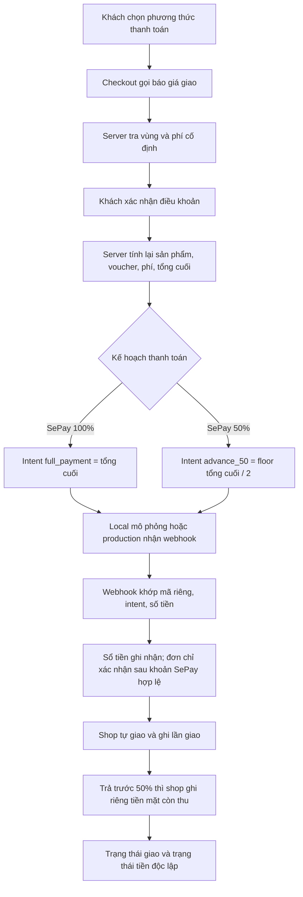

# Phần 17: Thanh toán trước và tự giao trên local

> Phạm vi: hoàn thiện luồng thử nghiệm local. Không kết nối SePay Live, không gọi Google Maps ở local, không áp dụng migration vào database đang cấu hình và không triển khai public.

## 1. Bản đồ vị trí code

| Phần | File | Trách nhiệm |
|---|---|---|
| Checkout | [public/index.html](../public/index.html), [public/detail.html](../public/detail.html), [public/js/checkout.js](../public/js/checkout.js) | Chọn trả đủ hoặc trả trước 50%, chọn phường theo nhóm, nhập riêng số nhà/đường và chỉ dẫn, chủ động yêu cầu báo giá, xác nhận điều khoản và mở màn hình chuyển khoản. |
| Khu vực giao | [public/js/delivery-areas.js](../public/js/delivery-areas.js), [DeliveryZoneRules.js](../server/application/DeliveryZoneRules.js) | Dropdown phường/xã và bảng gán vùng/giá cố định do server quyết định. |
| Quy tắc tiền | [server/application/PaymentRules.js](../server/application/PaymentRules.js) | Tính tiền phải trả trước, số còn thu khi giao và số tiền đã cấn vào đơn. |
| Quy tắc giao | [server/application/DeliveryService.js](../server/application/DeliveryService.js) | Tra phí cố định theo vùng; tọa độ pin chỉ kiểm tra phạm vi, không tính phí tuyến. |
| Nghiệp vụ đơn | [server/application/OrderService.js](../server/application/OrderService.js) | Tính lại giá/voucher/phí phía server, xác thực quyền đổi/hủy, điều phối giao hàng. |
| Lưu trữ | [server/adapters/out/persistence/PrismaOrderRepository.js](../server/adapters/out/persistence/PrismaOrderRepository.js) | Tạo intent riêng, ghi sổ thu/chi, lịch sử giao, yêu cầu đổi/hủy, chặn xử lý giao dịch lặp. |
| Đối soát SePay | [server/application/PaymentService.js](../server/application/PaymentService.js), [server/adapters/in/web/PaymentController.js](../server/adapters/in/web/PaymentController.js) | Mô phỏng local, xử lý webhook production, mã sai/không rõ được đưa vào danh sách cần đối soát. |
| Hoàn tiền | [server/adapters/out/persistence/PrismaRefundRepository.js](../server/adapters/out/persistence/PrismaRefundRepository.js) | Maker-checker, giới hạn theo tiền thực nhận, yêu cầu mã tham chiếu trước khi ghi hoàn tất. |
| Quản trị | [public/admin.html](../public/admin.html), [public/js/admin.js](../public/js/admin.js) | Ghi nhận tiền mặt, theo dõi lần giao, xử lý hủy/đổi, phí giao lại và giao dịch SePay chưa khớp. |
| Dữ liệu | [prisma/schema.prisma](../prisma/schema.prisma), [migration SQL](../prisma/migrations/20261114_payment_delivery_v1/migration.sql) | Schema sổ tiền, payment intent, lần giao, yêu cầu đổi/hủy và giao dịch chưa khớp. Migration mới được tạo, chưa áp dụng vào DB. |

## 2. Sơ đồ luồng



Khi đổi địa chỉ, server tra lại vùng từ phường mới. Phí tăng tạo intent mới và địa chỉ chỉ cập nhật sau khi thanh toán; phí giảm làm giảm số còn thu và khách có thể yêu cầu hoàn. Khi giao thất bại, nhân viên ghi liên hệ và thời điểm chờ 30 phút; khoản cấn và phí chuyến giao lại được ghi thành các dòng riêng.

## 3. Các quy tắc chính và lý do

- Đơn mới không có COD. Khách chọn **SePay trả đủ 100%** hoặc **trả trước 50% qua SePay, phần còn lại trả tiền mặt khi nhận**. Khoản thứ hai là thanh toán từng phần; không gọi là COD.
- Số trả trước bằng `Math.floor(totalAmount / 2)`; phần còn lại bằng tổng cuối trừ số trả trước. Tổng cuối đã bao gồm voucher và phí giao.
- Phí giao tra theo phường trên server: phường Tân Phú 0₫; phường Tân Sơn Nhì, Phú Thọ Hòa, Phú Thạnh, Tây Thạnh 35.000₫; các phường còn lại trong dropdown 50.000₫. Đây là bảng pilot cần chủ shop xác nhận và chỉnh theo chi phí chuyến thực tế trước khi công khai.
- Mỗi khoản cần chuyển có `reference_code`, số tiền và mục đích riêng. Webhook không suy luận loại tiền từ mã đơn. Tiền sai mã, sai số hoặc đến sau khi hủy không tự cộng vào khoản đã thanh toán.
- Địa chỉ checkout chọn phường/xã, nhập số nhà/tên đường/chỉ dẫn; phí được tra ngay theo phường. Báo giá có thể xem trước khi ghim, nhưng lúc tạo đơn/đổi địa chỉ phải gửi tọa độ pin để lưu cho người giao. Haversine chỉ dùng chặn pin xa hơn 15 km đường chim bay và gắn cờ cần shop xác nhận ở mép vùng; không dùng để ra phí.
- Backend không geocode, không gọi Google Routes/Places và không dùng kết quả giả lập. Tọa độ shop hiện có là giá trị mặc định cần xác nhận ghim thực tế trước khi bật bắt buộc pin. Tọa độ khách được xóa sau 30 ngày khi đơn đã hoàn tất/hủy; vùng và phí snapshot vẫn giữ để đối soát.
- Bản đồ tương tác chưa được tích hợp vào frontend ở phần backend này. Nếu dùng tile OpenStreetMap công cộng, cần hiển thị attribution và tuân thủ chính sách cache/usage; dịch vụ tile là best-effort, không có SLA. Xem [OSM Tile Usage Policy](https://operations.osmfoundation.org/policies/tiles/).
- Webhook trùng được chặn bằng unique `provider_tx_id`. Webhook không tìm thấy intent/đơn được lưu tại `unmatched_payment_transactions` và hiện trong Admin; nhân viên phải kiểm tra sao kê, ghi chú cách xử lý rồi mới đóng mục đối soát.
- Giao dịch hoàn được chuyển thủ công. Admin chỉ đánh dấu hoàn tất sau khi nhập mã tham chiếu chuyển tiền. Trạng thái đơn giao không tự đổi trạng thái thanh toán.

### Ví dụ code

```js
const amountDueNow = Math.floor(totalAmount / 2);
const amountDueAtDelivery = totalAmount - amountDueNow;
```

Server tính lại giá trong `OrderService.createOrder`; frontend chỉ hiển thị. Vì vậy sửa giá ở DevTools không làm thay đổi số tiền trong đơn. `PrismaOrderRepository.recordPaymentIntent` dùng giao dịch DB và chỉ cập nhật đơn sau khi kiểm tra intent còn chờ, mã đúng, số tiền đúng, mục đích đúng và đơn chưa hủy.

## 4. Nhật ký lỗi và cách xử lý

| Hiện tượng | Nguyên nhân | Cách xử lý |
|---|---|---|
| Intent trả trước 50% bị hiển thị là “thanh toán đủ” | UI so sánh purpose `cod_deposit`, trong khi intent mới dùng `advance_50` | Đổi nhãn theo purpose: trả trước, trả đủ, phí điều chỉnh hoặc phí giao lại. |
| Webhook chứa mã chuyển không tìm được đơn sẽ biến mất khỏi ứng dụng | Luồng cũ chỉ trả `processed: false` | Tạo bảng giao dịch chưa khớp, endpoint nhân viên và bảng đối soát trong Admin; khoản này không được tự nhận là tiền của đơn nào. |
| Cấu hình local trỏ nhầm Google có thể gọi API thật | Chỉ dựa vào biến cấu hình mode | Chặn Places/Routes ngoài production; local dùng mô phỏng. |
| Webhook SePay cần xác nhận đã nhận sự kiện | SePay yêu cầu body `{ success: true }`; một số cấu hình cũ/OAuth chỉ chấp nhận HTTP 201 | Endpoint trả HTTP 201 sau khi lưu sự kiện thành công. SePay cũng yêu cầu chống giao dịch trùng theo `id`; xem [hướng dẫn Webhook SePay](https://docs.sepay.vn/tich-hop-webhooks.html). |

## 5. Vấn đáp và nguồn tham khảo

**Hỏi: Vì sao em bỏ COD?**  
Đáp: Đây là lựa chọn theo điều kiện vận hành của tiệm: hiện chỉ một người giao hàng, nên cần nhận trước một phần để giảm rủi ro khách không nhận. Khách vẫn có lựa chọn trả phần còn lại bằng tiền mặt khi nhận, nhưng hệ thống gọi đó là thanh toán từng phần vì đã có khoản chuyển trước.

**Hỏi: Tại sao cọc bằng 50% tổng cuối?**  
Đáp: Đây là chính sách đã thống nhất với chủ shop, không phải quy định bắt buộc của mọi cửa hàng. Tính trên tổng cuối giúp khoản trả trước tính cả voucher và phí giao; làm tròn xuống giúp phần còn lại luôn cộng đúng tổng.

**Hỏi: Dựa vào đâu để tích hợp SePay?**  
Đáp: Em dựa vào tài liệu Webhook chính thức của SePay để xử lý POST, xác thực API key, kiểm tra giao dịch tiền vào, trả phản hồi thành công và chống giao dịch lặp. Còn mã intent riêng, khớp số tiền/mục đích và sổ thu chi là thiết kế của hệ thống để không gắn nhầm tiền giữa các đơn.

**Hỏi: Vì sao dùng Maps nếu API có thể tính phí?**  
Đáp: Bản đồ dùng để khách ghim vị trí và shop mở đường đi; phí do bảng vùng trong server tính. Nếu dùng tile OpenStreetMap công cộng phải ghi nguồn và tuân thủ chính sách sử dụng; tile không có SLA. Shop có thể mở đường đi trong Google Maps bằng URL mà không cần API key.

**Hỏi: Vì sao dùng phí theo phường thay vì phí theo tuyến?**  
Đáp: Shop hiện tự giao và cần tránh API tính tuyến có billing. Backend gán mỗi phường vào một vùng phí; pin chỉ giúp người giao tìm địa chỉ và kiểm tra phạm vi. Đây là chính sách vận hành của shop, không phải giá cước chính thức của hãng vận chuyển.

**Hỏi: Em đã kiểm tra trên database thật chưa?**  
Đáp: Chưa. Migration được tạo nhưng chưa áp dụng vì chưa xác nhận database hiện tại là DB test cô lập. Trước khi dùng public, cần tạo DB test riêng, áp dụng migration ở đó, chạy API/UI/E2E, sau đó cấu hình SePay Live, HTTPS, địa chỉ tiệm và quota Maps.

### Nguồn chính thức

- [SePay — Hướng dẫn tích hợp Webhook](https://docs.sepay.vn/tich-hop-webhooks.html)
- [OpenStreetMap — Tile Usage Policy](https://operations.osmfoundation.org/policies/tiles/)
- [Google Maps — Maps URLs](https://developers.google.com/maps/documentation/urls/get-started)
- [Nghị quyết 1685/NQ-UBTVQH15 — sắp xếp đơn vị hành chính cấp xã TP.HCM năm 2025](https://xaydungchinhsach.chinhphu.vn/toan-van-nghi-quyet-so-1685-nq-ubtvqh15-sap-xep-cac-dvhc-cap-xa-cua-thanh-pho-ho-chi-minh-nam-2025-119250616211341304.htm)

## 6. Kết quả kiểm tra local trước khi chuyển sang phí vùng

- Đạt: 10/10 kiểm thử unit quy tắc tiền, mốc phí giao, chặn gọi Google trên local và webhook chưa khớp.
- Đạt: `npx prisma validate` và kiểm tra cú pháp Node.js cho các file backend/frontend đã sửa.
- Đạt: đối chiếu chênh lệch Prisma schema với schema trước thay đổi; migration SQL chưa được áp dụng.
- Chưa chạy migration, truy vấn API có DB, UI/E2E hoặc webhook thật vì chưa xác nhận được một database test cô lập. Không dùng database đang cấu hình trong `.env` cho các thao tác ghi.
- Các kiểm tra trên được thực hiện trước khi thay phí km bằng phí vùng; không xác nhận thay đổi mới ở mục 7. Trước khi mở public cần tạo DB test và kiểm tra luồng map/pin với tọa độ tiệm chính xác.
- Countdown VietQR hiện bám hạn thật của payment intent; không còn nút gia hạn chỉ đổi giờ ở trình duyệt. Khi hết hạn, khách cần tạo đơn mới hoặc liên hệ tiệm nếu đã chuyển tiền.

## 7. Chuyển phí sang vùng cố định (15/11/2026)

- Backend đã đổi từ phí km/mock/Google Routes sang bảng phí pilot theo phường; báo giá có thể trả ngay khi chỉ biết phường, không cần địa chỉ đường hoặc API ngoài.
- API báo giá nhận `latitude`/`longitude` (hoặc `deliveryLatitude`/`deliveryLongitude`) tùy chọn để xem vùng trước khi ghim. Tạo đơn và đổi địa chỉ yêu cầu tọa độ hợp lệ; pin quá 15 km đường chim bay bị từ chối, pin xa tương đối so với vùng yêu cầu shop xác nhận. Khoảng cách không tham gia tính phí.
- Prisma lưu `delivery_zone`, `delivery_latitude`, `delivery_longitude`; đổi địa chỉ sẽ chụp vùng và tọa độ mới vào yêu cầu, và cập nhật sau khi được áp dụng. Tọa độ được xóa sau 30 ngày khi đơn kết thúc; phí/vùng lịch sử được giữ.
- Mức pilot hiện tại: phường Tân Phú miễn phí; 4 phường Tân Phú lân cận 35.000₫; các phường còn lại trong dropdown 50.000₫. Cần xác nhận lại phân vùng, tọa độ chính xác của tiệm và chi phí chuyến trước khi dùng thật.
- Chưa sửa frontend vì Anti đang làm giao diện; giao diện cần gửi tọa độ pin và gọi `POST /api/delivery/quote` khi phường được chọn. Chưa chạy migration hay test suite.
- Chưa chạy test suite, kiểm tra API có DB hoặc migration sau thay đổi phí vùng.
