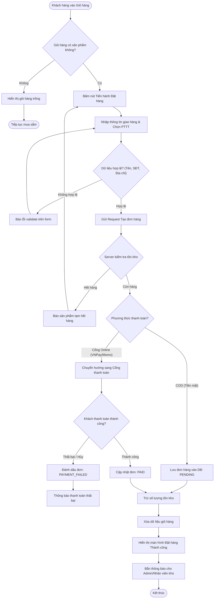
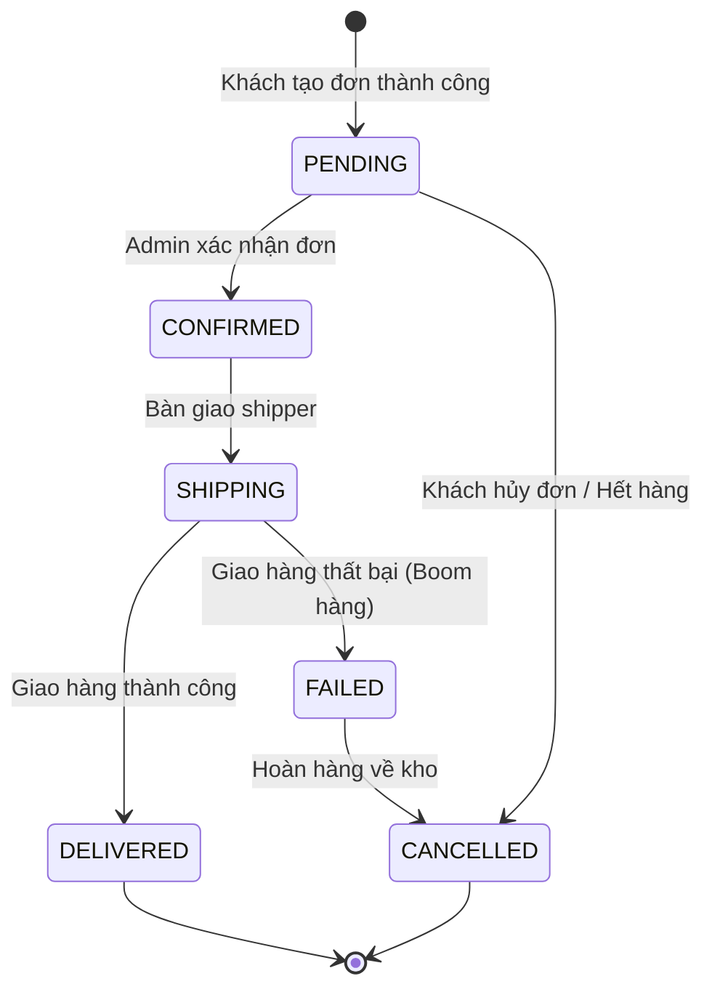
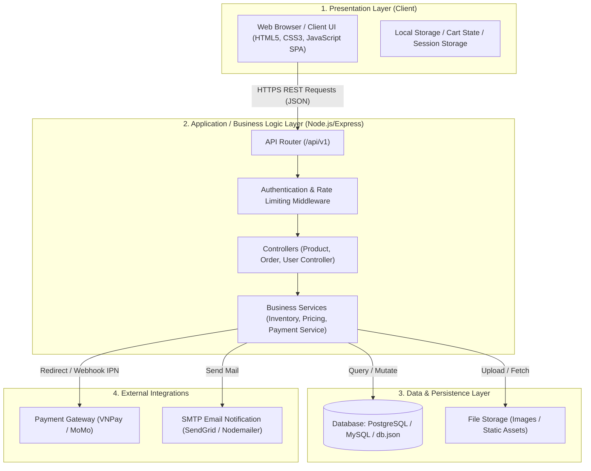
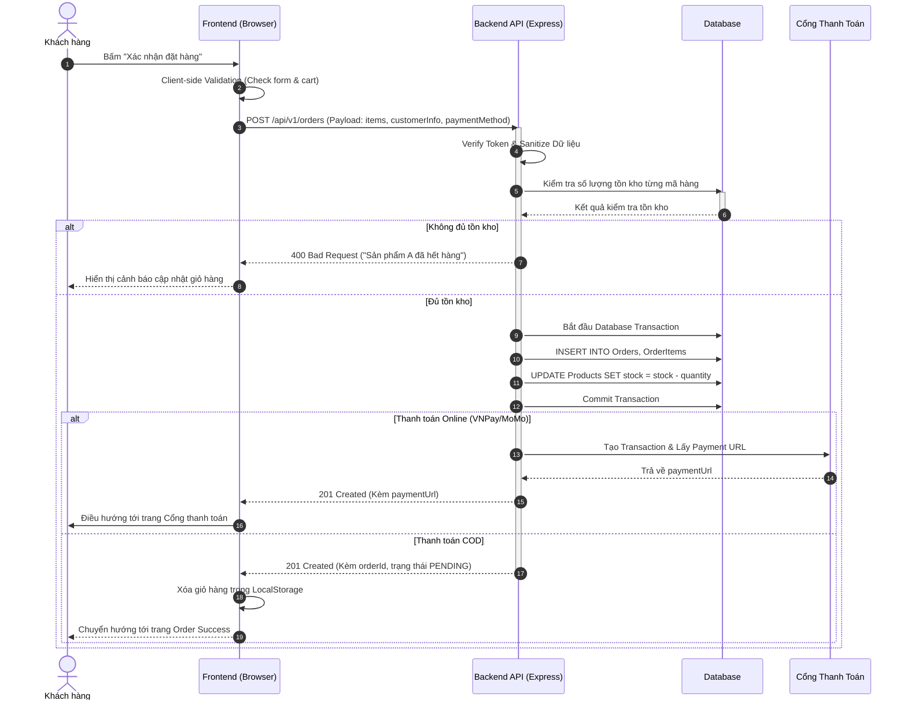
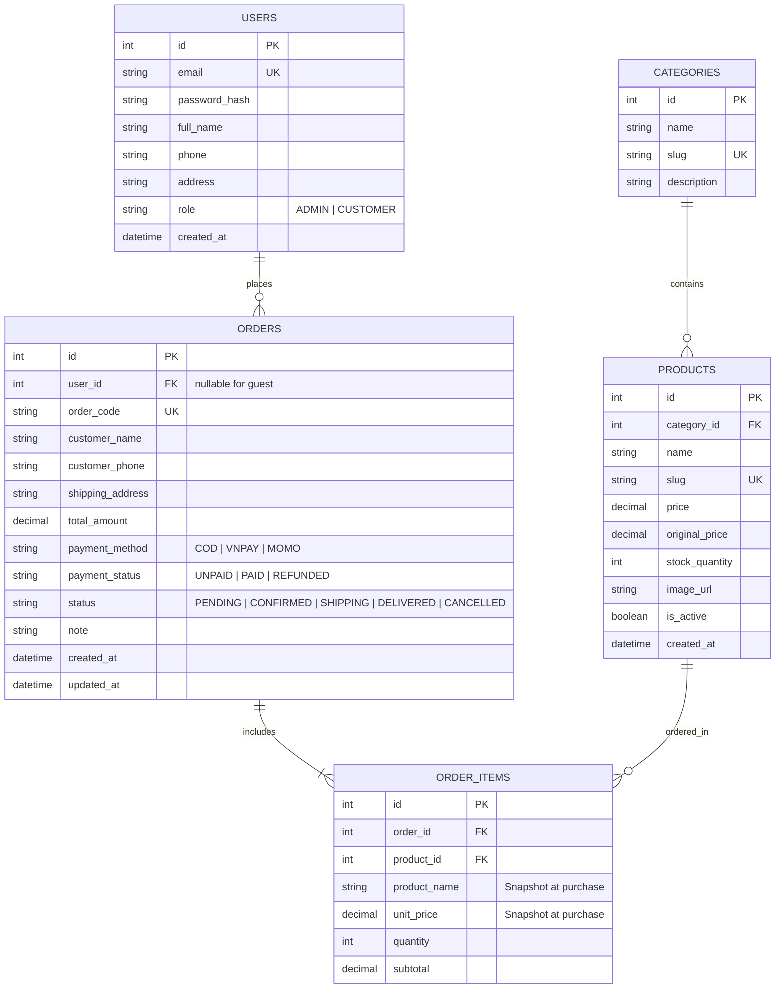
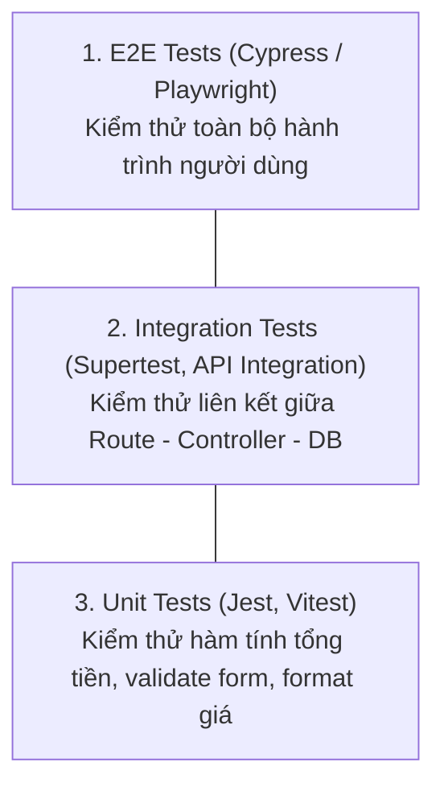

# TÀI LIỆU THIẾT KẾ KIẾN TRÚC PHẦN MỀM (SOFTWARE ARCHITECTURE DESIGN)
> **Dự án mẫu:** Hệ thống Web Bán Hàng Trực Tuyến (E-Commerce Web Application)  
> **Quy chuẩn:** 8 giai đoạn phát triển phần mềm thực chiến trong doanh nghiệp  
> **Định dạng:** GitHub Flavored Markdown + Mermaid Diagram

---

## MỤC LỤC
1. [Giai đoạn 1: Phân tích yêu cầu (Requirements Analysis)](#1-phân-tích-yêu-cầu-requirements-analysis)
2. [Giai đoạn 2: Xác định chức năng (Feature Identification)](#2-xác-định-chức-năng-feature-identification)
3. [Giai đoạn 3: Thiết kế Workflow từng chức năng (Workflow Diagrams)](#3-thiết-kế-workflow-từng-chức-năng-workflow-diagrams)
4. [Giai đoạn 4: Thiết kế kiến trúc phần mềm (Software Architecture Design)](#4-thiết-kế-kiến-trúc-phần-mềm-software-architecture-design)
5. [Giai đoạn 5: Thiết kế Cơ sở dữ liệu (Database Design & ERD)](#5-thiết-kế-cơ-sở-dữ-liệu-database-design--erd)
6. [Giai đoạn 6: Thiết kế API (API Specifications & Contract)](#6-thiết-kế-api-api-specifications--contract)
7. [Giai đoạn 7: Kế hoạch lập trình Frontend & Backend (Implementation Plan)](#7-kế-hoạch-lập-trình-frontend--backend-implementation-plan)
8. [Giai đoạn 8: Chiến lược kiểm thử (Testing Strategy & Test Cases)](#8-chiến-lược-kiểm-thử-testing-strategy--test-cases)

---

## 1. PHÂN TÍCH YÊU CẦU (REQUIREMENTS ANALYSIS)

### 1.1. Bối cảnh & Mục tiêu dự án
Xây dựng một ứng dụng web cho phép người dùng tìm kiếm, xem chi tiết, thêm vào giỏ hàng và đặt mua các sản phẩm hoa tươi trực tuyến; đồng thời cung cấp giao diện quản trị (Admin) để quản lý sản phẩm, đơn hàng và doanh thu.

### 1.2. Yêu cầu chức năng (Functional Requirements - FR)
- **FR-01: Quản lý danh mục & sản phẩm:** Xem danh sách, tìm kiếm, lọc theo giá/loại hoa, xem chi tiết sản phẩm.
- **FR-02: Giỏ hàng (Shopping Cart):** Thêm sản phẩm, cập nhật số lượng, xóa khỏi giỏ, lưu trạng thái giỏ hàng.
- **FR-03: Đặt hàng & Thanh toán (Checkout):** Nhập thông tin giao hàng, chọn phương thức thanh toán (COD hoặc Cổng thanh toán trực tuyến), xác nhận tạo đơn.
- **FR-04: Quản lý đơn hàng:** Khách hàng tra cứu lịch sử đơn hàng; Quản trị viên cập nhật trạng thái đơn (Chờ xử lý, Đang giao, Hoàn tất, Hủy).

### 1.3. Yêu cầu phi chức năng (Non-Functional Requirements - NFR)
- **NFR-01 (Hiệu năng - Performance):** Thời gian tải trang ban đầu (FCP) dưới 1.5 giây; thời gian phản hồi API dưới 300ms.
- **NFR-02 (Bảo mật - Security):** Xác thực an toàn, mã hóa dữ liệu nhạy cảm, chống các lỗ hổng cơ bản (XSS, SQL/NoSQL Injection, CSRF).
- **NFR-03 (Khả năng mở rộng - Scalability):** Tách biệt tầng Frontend và Backend (Decoupled), sẵn sàng chuyển đổi từ monolith sang microservices khi lượng truy cập tăng.
- **NFR-04 (Tính tương thích - Compatibility):** Giao diện Responsive hoạt động mượt mà trên Mobile (>= 375px), Tablet và Desktop.

---

## 2. XÁC ĐỊNH CHỨC NĂNG (FEATURE IDENTIFICATION)

### 2.1. Ma trận chức năng theo phân quyền (Role-Based Feature Matrix)

| Module | Khách vãng lai (Guest) | Khách hàng đăng nhập (Customer) | Quản trị viên (Admin) |
| :--- | :---: | :---: | :---: |
| **Xem & Tìm kiếm sản phẩm** | Có | Có | Có |
| **Quản lý giỏ hàng** | Có (Lưu Local) | Có (Đồng bộ tài khoản) | Không |
| **Đặt hàng & Thanh toán** | Có | Có | Không |
| **Xem lịch sử đơn hàng** | Không (Chỉ tra cứu qua Mã) | Có (Lưu trong hồ sơ) | Toàn quyền xem & lọc |
| **Quản lý kho & Sản phẩm** | Không | Không | Toàn quyền (CRUD) |
| **Duyệt & Đổi trạng thái đơn** | Không | Không | Toàn quyền |

### 2.2. User Story mẫu (Feature trọng tâm: Đặt hàng)
> **User Story US-01:**  
> Là một **Khách mua hàng**, tôi muốn **nhập thông tin nhận hàng và bấm Đặt hàng**, để **hệ thống ghi nhận đơn và giao hoa đến đúng địa chỉ cho tôi**.
>
> **Acceptance Criteria (Tiêu chí nghiệm thu):**
> 1. Họ tên, Số điện thoại (đúng định dạng 10 số), Địa chỉ giao hàng không được để trống.
> 2. Giỏ hàng phải có ít nhất 1 sản phẩm còn tồn kho.
> 3. Nếu đặt hàng thành công: Tạo bản ghi đơn hàng với trạng thái `PENDING`, trừ số lượng tồn kho tương ứng, làm sạch giỏ hàng và hiển thị mã đơn hàng kèm thông báo chúc mừng.
> 4. Nếu có lỗi mạng hoặc lỗi hệ thống: Hiển thị thông báo lỗi rõ ràng, không làm mất giỏ hàng của khách.

---

## 3. THIẾT KẾ WORKFLOW TỪNG CHỨC NĂNG (WORKFLOW DIAGRAMS)

### 3.1. Workflow Tổng quan: Luồng Mua hàng & Thanh toán (Checkout Flow)



### 3.2. State Diagram: Vòng đời trạng thái đơn hàng (Order State Machine)



---

## 4. THIẾT KẾ KIẾN TRÚC PHẦN MỀM (SOFTWARE ARCHITECTURE DESIGN)

### 4.1. Kiến trúc phân tầng tổng thể (3-Tier Layered Architecture)



### 4.2. Sequence Diagram: Tương tác chi tiết khi Tạo đơn hàng (End-to-End API Flow)



---

## 5. THIẾT KẾ CƠ SỞ DỮ LIỆU (DATABASE DESIGN & ERD)

### 5.1. Sơ đồ thực thể quan hệ (ERD - Entity Relationship Diagram)



### 5.2. Nguyên tắc bất biến khi thiết kế Database
1. **Lưu vết giá (Price Snapshotting):** Trong bảng `ORDER_ITEMS`, bắt buộc phải có trường `unit_price` lưu giá tại đúng thời điểm mua. Tuyệt đối không được join ngược lại bảng `PRODUCTS` để lấy giá khi tính tiền lịch sử đơn (vì giá sản phẩm có thể thay đổi trong tương lai).
2. **Khóa ngoại & Toàn vẹn tham chiếu:** Đơn hàng của khách vãng lai (Guest) có `user_id = NULL`, nhưng thông tin người nhận (`customer_name`, `customer_phone`, `shipping_address`) được lưu trực tiếp vào bảng `ORDERS`.
3. **Đánh Index:** Đánh Index trên các cột tìm kiếm thường xuyên: `slug`, `category_id`, `order_code`, `status`, `created_at`.

---

## 6. THIẾT KẾ API (API SPECIFICATIONS & CONTRACT)

Hệ thống tuân thủ nghiêm ngặt chuẩn kiến trúc **RESTful API**, dữ liệu trao đổi qua JSON, sử dụng đúng HTTP Verbs và HTTP Status Codes.

### 6.1. Danh sách Endpoints cốt lõi

| Phương thức | URI Endpoint | Quyền hạn | Mục đích |
| :--- | :--- | :--- | :--- |
| `GET` | `/api/v1/products` | Public | Lấy danh sách sản phẩm (hỗ trợ pagination, filter, search) |
| `GET` | `/api/v1/products/:id` | Public | Lấy thông tin chi tiết một sản phẩm |
| `POST` | `/api/v1/orders` | Public / Customer | Tạo mới một đơn đặt hàng |
| `GET` | `/api/v1/orders/:orderCode` | Public / Customer | Tra cứu chi tiết đơn hàng theo mã đơn |
| `GET` | `/api/v1/admin/orders` | Admin | Lấy toàn bộ danh sách đơn hàng cho dashboard quản trị |
| `PATCH` | `/api/v1/admin/orders/:id/status` | Admin | Cập nhật trạng thái đơn (CONFIRMED, SHIPPING...) |

---

### 6.2. Chi tiết API Contract tạo đơn hàng: `POST /api/v1/orders`

#### Request Header
```http
Content-Type: application/json
Authorization: Bearer <token> (Optional nếu là khách đã đăng nhập)
```

#### Request Body
```json
{
  "customerName": "Nguyen Van A",
  "customerPhone": "0912345678",
  "customerEmail": "nguyenvana@gmail.com",
  "shippingAddress": "123 Nguyen Hue, Quan 1, TP.HCM",
  "paymentMethod": "COD",
  "note": "Giao vào giờ hành chính, gọi trước khi đến",
  "items": [
    {
      "productId": 101,
      "quantity": 2
    },
    {
      "productId": 105,
      "quantity": 1
    }
  ]
}
```

#### Success Response: `201 Created`
```json
{
  "success": true,
  "message": "Đơn hàng đã được tạo thành công",
  "data": {
    "orderId": 452,
    "orderCode": "ORD-20261105-8839",
    "totalAmount": 750000,
    "status": "PENDING",
    "paymentMethod": "COD",
    "paymentStatus": "UNPAID",
    "createdAt": "2026-11-05T13:45:00.000Z"
  }
}
```

#### Error Response: `400 Bad Request` (Dữ liệu không hợp lệ)
```json
{
  "success": false,
  "errorCode": "INVALID_INPUT",
  "message": "Số điện thoại không đúng định dạng 10 chữ số",
  "errors": [
    {
      "field": "customerPhone",
      "issue": "Must be a valid 10-digit Vietnamese phone number"
    }
  ]
}
```

---

## 7. KẾ HOẠCH LẬP TRÌNH FRONTEND VÀ BACKEND (IMPLEMENTATION PLAN)

### 7.1. Cấu trúc thư mục tiêu chuẩn (Project Organization)
```text
project-root/
├── client/ (Frontend)
│   ├── assets/ (css, images, fonts)
│   ├── js/
│   │   ├── api/ (axios/fetch service wrapper, api endpoints)
│   │   ├── components/ (cart-drawer, navbar, modal)
│   │   ├── pages/ (index, detail, checkout, admin)
│   │   └── utils/ (formatters, validators, storage)
│   └── index.html, detail.html, orders.html
├── server/ (Backend)
│   ├── config/ (db connection, env loader)
│   ├── controllers/ (order.controller.js, product.controller.js)
│   ├── middlewares/ (auth.js, errorHandler.js, validator.js)
│   ├── models/ (product.model.js, order.model.js)
│   ├── routes/ (api.routes.js)
│   └── app.js (Express server entry point)
└── docs/
    └── SOFTWARE_ARCHITECTURE_DESIGN.md
```

### 7.2. Quy ước phát triển (Development Standards)
1. **Branching Strategy (Git Flow):**
   - `main`: Nhánh production ổn định.
   - `develop`: Nhánh tích hợp tính năng chung.
   - `feature/<feature-name>`: Nhánh làm từng tính năng riêng biệt (VD: `feature/order-checkout`).
2. **Quy tắc Commit (Conventional Commits):**
   - `feat: add order creation validation`
   - `fix: resolve stock deduction race condition`
   - `refactor: clean up cart drawer state management`

---

## 8. CHIẾN LƯỢC KIỂM THỬ (TESTING STRATEGY & TEST CASES)

### 8.1. Kim tự tháp kiểm thử (Testing Pyramid)


### 8.2. Ma trận Test Case mẫu cho chức năng Tạo đơn hàng

| ID | Kịch bản kiểm thử (Test Scenario) | Input | Kết quả mong đợi (Expected Result) | Loại |
| :---: | :--- | :--- | :--- | :---: |
| **TC-01** | Tạo đơn hàng thành công với COD | Dữ liệu form đầy đủ, hợp lệ, giỏ hàng có 2 món còn hàng | Mã HTTP 201, tạo mã `orderCode`, tồn kho giảm, giỏ hàng trống | Positive |
| **TC-02** | Khách bỏ trống trường bắt buộc | Để trống trường Số điện thoại | Mã HTTP 400, trả về thông báo lỗi đỏ tại ô SĐT | Negative |
| **TC-03** | Đặt mua sản phẩm vượt quá tồn kho | Sản phẩm còn 1 cái trong kho, khách đặt số lượng 2 | Báo lỗi hết hàng, giao dịch rollback, tồn kho giữ nguyên | Boundary |
| **TC-04** | Người dùng bấm "Đặt hàng" liên tục nhiều lần (Double Click / Spam) | Bấm nút Submit 5 lần trong 1 giây | Client khóa nút (disable + spinner), Server xử lý Idempotency, chỉ tạo duy nhất 1 đơn | Concurrency |
| **TC-05** | Mất kết nối mạng khi đang gửi đơn | Ngắt mạng ngay lúc bấm Submit | Hiển thị Toast thông báo mất kết nối, giữ nguyên dữ liệu trên form | Edge Case |

---

> [!NOTE]
> Tài liệu này đóng vai trò là "Bản thiết kế kỹ thuật (Blueprint)" trước khi viết bất kỳ dòng mã nào. Nó giúp toàn bộ đội ngũ (Product Owner, Frontend, Backend, Tester) có chung một góc nhìn, tránh hiểu lầm và giảm thiểu tối đa chi phí sửa đổi khi đi làm thực tế.

